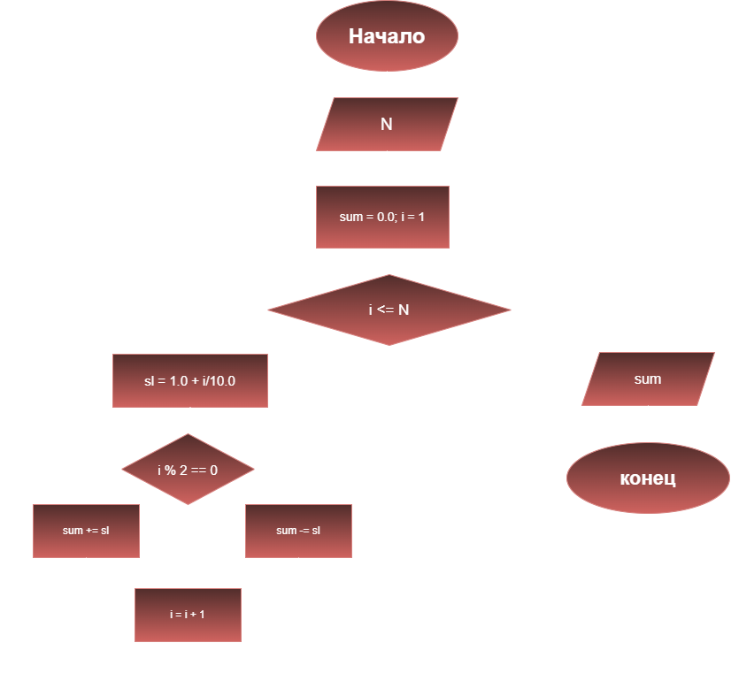

# Домашнее задание №8
## Условие задачи
Вычислите для целого значения N (N < 10), заданного пользователем, 
значение знакопеременного выражения 1.1 - 1.2 + 1.3 - ...
## 1.Алгоритм и блок-схема
### Алгоритм
1. **Начало** 
2. Задать исходные файлы:
- `N` - введённое пользователем число, меньшее 10
3.  Инициализация переменных
- `sl` - слагаемые
- `sum` - сумма
4. Запускаем цикл, с помощью которого перебираются слагаемые
- `for (int i = 1; i <= N; ++i) {
	sl = 1.0 + i / 10.0;`
5. Проверяем условие чётности слагаемого, чтобы поставить знак, если i - чётное, то минус,
  если нечётное - плюс, добавляем слагаемые в сумму
- `if (i % 2 == 0) {
	sum -= sl;
}
else {
	sum += sl;`
6. Вывести результат проверки условия на экран с подстановкой всех значений в текст.
7. **Конец**

### Блок-схема



## 2. Реализация программы
```c 
#include <stdio.h>
#include <locale.h>
int main() {
	setlocale(LC_CTYPE, ".UTF-8");
	int N;
	double sl, sum;
    sum = 0.0;
  printf("Контрольный пример: при N = 5 значение выражения равно 1.3");
	printf("Введите целое число N, которое меньше 10: ");
	scanf("%d", N);
	for (int i = 1; i <= N; ++i) {
		sl = 1.0 + i / 10.0;
		if (i % 2 == 0) {
			sum -= sl;
		}
		else {
			sum += sl;
		}
	}
	printf("Значение выражения для N = %d равно %.3f\n", N, sum);
  printf("Ответ: при N = %d, значение выражения равно %.3f", N, sum);
	return 0;
}
```

## 3. Результаты работы программы 
```c
Контрольный пример: при N = 5 значение выражения равно 1.3
Введите целое число N, которое меньше 10: 5
Значение выражения для N = 5 равно 1.3
Ответ: при N = 5, значение выражения равно 1.300
```


## 4. Информация о разработчике
Выполнила Яценко Анна, группа бОТИ-261
